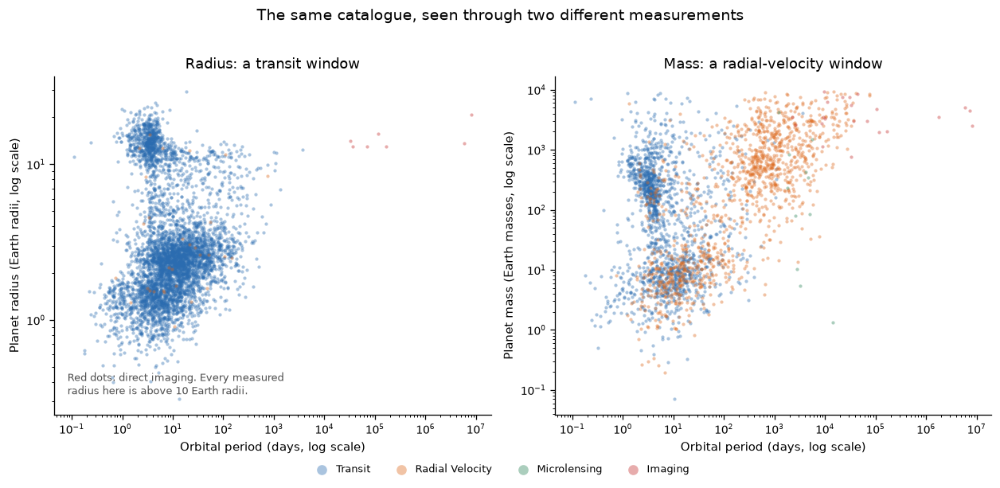

# CUI JUNRUI

**Data science portfolio**

I am a data science student at the University of Macau. I work mostly in Python — pandas for preparing data, matplotlib for explaining it, scikit-learn for modelling — and I care most about the step between a chart and a claim: deciding what a result actually supports, and saying so plainly.

This site is built from one markdown file with GitHub Pages. Everything I show here links to code you can run.

---

## Skills

- **Data preparation:** pandas, NumPy — missing values, type handling, joins, reshaping
- **Analysis and modelling:** exploratory analysis, correlation and regression, cross-validation, Ridge and grid search (scikit-learn)
- **Communication:** matplotlib, seaborn, folium — static figures, maps, dashboards
- **Workflow:** Jupyter, Git and GitHub, reproducible notebooks with pinned requirements

## Projects

### Exoplanet catalogue: a map of planets, or a map of telescopes?

**Question.** The NASA Exoplanet Archive lists 6,451 confirmed planets. Does the shape of that catalogue describe planets, or the instruments that found them?

**What I found.** Transit photometry accounts for 74% of all confirmed planets, and each detection method reports a different kind of world: the median orbital period is 8 days for transits, 304 days for radial velocity and 33,100 days for direct imaging. Size is even more method-bound — transits have a radius for 99.5% of their planets, radial velocity for 2.5%, and microlensing for none. The catalogue is a record of our instruments at least as much as a census of planets.

**Limitation.** Three things bound this analysis. First, only successfully measured planets appear, so planets that are small, faint or far from their star are largely missing — a survivorship bias. Second, the groups are very unequal: thousands of transit planets against a few dozen imaged ones, so the comparison is indicative rather than statistical. Third, transits and radial velocity overlap at short periods, which makes the method divide a tendency rather than a hard boundary.

**Status:** completed — data snapshot and analysis from October 2026 · [Code and full write-up](https://github.com/CuiJeremy/data-science-project)
